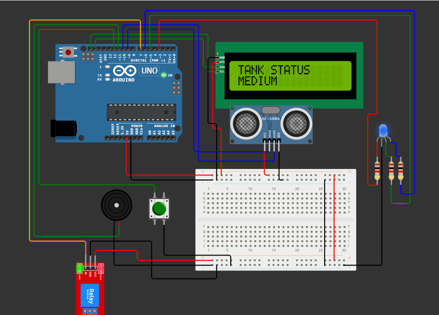

# SmartTank
Arduino-based automated water level monitoring and pump control system featuring non-contact ultrasonic distance sensing, hysteresis pump logic, multi-screen I2C LCD navigation, and fail-safe sensor-error detection.
# Smart Water Level Monitoring & Automatic Pump Control System

An Arduino-based automation system that monitors real-time water levels using an ultrasonic sensor, automatically controls a water pump, and provides visual and audio feedback via an LCD screen, RGB LED, and buzzer.

## Key Features
* **Real-Time Level Sensing:** Measures water distance and calculates water level percentage using an ultrasonic sensor.
* **Automatic Pump Control:** Automatically turns the water pump ON when water levels drop too low and OFF when the tank is full.
* **Interactive LCD Display:** Shows pump status (ON/OFF), water level percentage, raw sensor readings, and text indicators (`LOW`, `MEDIUM`, `HIGH`).
* **Push-Button Screen Navigation:** Allows the user to toggle or cycle through display screens using a push button.
* **Visual & Audio Alerts:** Changes an RGB LED color based on the current water level (`LOW`, `MEDIUM`, `HIGH`) and triggers a buzzer for critical threshold alerts.

## Hardware Components
* **Microcontroller:** Arduino Uno R3
* **Sensor:** HC-SR04 Ultrasonic Distance Sensor
* **Display:** 16x2 LCD Display (with I2C module / standard parallel interface)
* **Actuators:** Water Pump (driven via Relay Module)
* **Indicators:** Common Cathode/Anode RGB LED & Active/Passive Buzzer
* **Input:** Tactile Push Button

## Circuit Diagram

*(Note: Ensure your uploaded circuit image is named `circuit_diagram.png`, or update the filename inside the parentheses above to match your uploaded file.)*

## Software & Libraries
* **Programming Language:** C++ (Arduino IDE)
* **Required Libraries:** 
  * `LiquidCrystal.h` or `LiquidCrystal_I2C.h` *(keep whichever matches your code)*

## How to Use
1. Wire the components according to the circuit diagram above.
2. Open the `.ino` source file in the **Arduino IDE**.
3. Select **Arduino Uno** under `Tools > Board` and choose the correct COM port.
4. Upload the sketch to the board and press the push button to cycle through the LCD status views.
